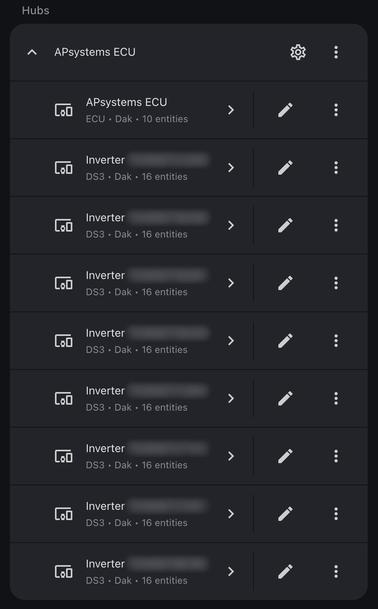

#  APsystems Modbus for Home Assistant

[](https://github.com/christianvaes/homeassistant-apsystems_modbus/releases)
[](https://hacs.xyz)
[](https://github.com/christianvaes/homeassistant-apsystems_modbus/actions/workflows/ci.yml)
[](https://www.home-assistant.io)
[](https://github.com/christianvaes/homeassistant-apsystems_modbus/commits/main)
[](https://www.paypal.com/donate/?business=FAQ9J5JDQY7NW&no_recurring=1&currency_code=EUR)

Fully local Home Assistant integration for solar panels with APsystems
microinverters and an ECU, over Modbus TCP.


Features:

- **One device for the whole system (the ECU)** with current solar power,
  energy today, lifetime energy for the Energy dashboard, highest power ever
  measured and inverters online.
- **One device per microinverter** with power, energy today, AC voltage and
  current, frequency, temperature, status and event code. Each panel gets its
  own power, voltage and current.
- **Control: power limit and inverter output.** Curtail the output of all
  inverters, in percent or in kW, or turn them all off. By hand or from
  an automation. With a dynamic tariff you can stop at negative prices and go
  back to full power when they are positive again.
- **Setup**: the ECU is discovered on your network and the inverters are found
  automatically.

Unofficial, not affiliated with APsystems. Use at your own risk.

## Supported hardware

| ECU | Serial starts with | Modbus from firmware | Connection | Status |
|---|---|---|---|---|
| ECU-R | 2160 | 1.3.7 | Ethernet only | Tested (1.3.23 and 1.3.24, DS3 inverters) |
| ECU-R Pro | 2162 | 2.0.2 | Ethernet or Wi-Fi | Works, [reported by users](https://github.com/christianvaes/homeassistant-apsystems_modbus/discussions/2) (2.1.32A, DS3 inverters) |
| ECU-C | 215 | C1.1.3 | Ethernet or Wi-Fi | Works, [reported by a user](https://github.com/christianvaes/homeassistant-apsystems_modbus/discussions/2#discussioncomment-19124766) |
| ECU-B | 2163 | not supported by APsystems | – | Not supported |

Supported ECUs have a SunSpec logo on the device.

| Inverter | Status |
|---|---|
| DS3, DS3-L | Tested, with power limit and Inverter output |
| QS1 | Works, [reported by a user](https://github.com/christianvaes/homeassistant-apsystems_modbus/discussions/2#discussioncomment-19124766) |
| YC600 | Works, [reported by users](https://github.com/christianvaes/homeassistant-apsystems_modbus/discussions/2#discussioncomment-19124766), also with [Inverter output](https://gathering.tweakers.net/forum/list_message/86436202#86436202) |

Other models should work. For the EZ1, use the core `apsystems` integration.
Have an untested ECU or inverter? Open an issue with a register dump (see
Troubleshooting).

## Before you start

1. Give the ECU a fixed IP address. Connect it as shown in the table.
2. **Enable Modbus on the ECU.** It is off by default. The setting is in the
   *EMA Manager* app, which normally needs an installer account. Without one,
   use the ECU's local access point:
   - Install EMA Manager on your phone.
   - Press the **AP button** on the side of the ECU and connect your phone to
     the Wi-Fi network it starts (`ECU_R_2160…`, default password `88888888`).
   - Open EMA Manager and choose **Local Access**.
   - Go to *Workspace → Modbus settings* (in some app versions *Modbus
     Configuration*), switch Modbus on, give every inverter an address (1, 2,
     3, …) and save.
3. With Modbus on, APsystems features such as Dynamic Tariff stop working.
4. Let **nothing else talk to the ECU over Modbus**. In tests a second
   connection made the ECU stop answering the integration.
5. Home Assistant 2026.10.0 or newer.

## Installation and setup

[](https://my.home-assistant.io/redirect/hacs_repository/?owner=christianvaes&repository=homeassistant-apsystems_modbus&category=integration)

Open the repository in HACS with the button, or search for *APsystems Modbus*
in HACS. Choose *Download* and restart Home Assistant.

Home Assistant discovers the ECU on your network. Accept it under *Settings →
Devices & services*, or add it yourself with the IP address of the ECU (port
502):

[](https://my.home-assistant.io/redirect/config_flow_start/?domain=apsystems_modbus)

Leave the inverter addresses empty to find the inverters automatically. Enter
the installation power (kW) to get the most out of the power limit, and the
lifetime energy from the EMA app (kWh) if the counter should continue from
there. Both can also be set later under *Configure*.

You get one device for the ECU and one device per inverter.

<table>
  <tr>
    <th>Devices</th>
    <th>One inverter</th>
  </tr>
  <tr>
    <td valign="top"></td>
    <td valign="top"></td>
  </tr>
</table>

Under *Configure* you can also reset the peak power. A lifetime correction
counts once as production in the Energy dashboard. Undo that under *Settings →
Tools → Statistics*.

## Energy dashboard

In the Energy dashboard, choose *Edit dashboard → Solar panels*. Pick
**Lifetime energy** of the ECU device for *Solar production energy* and
**Power** for *Solar production power*.

## Power limit

**Power limit** on the ECU device curtails the output of all inverters, in
whole percent. 100 % is no limit.

- Inverters follow a change within one or two ECU rounds, usually within 10
  minutes.
- At 0 % an ECU-R lets each inverter still deliver about 10 to 30 W. An
  ECU-R Pro turns them fully off.
- If the ECU loses the limit, for example after a restart, the integration
  sends it again.
- Enter the installation power under *Configure*. You can then also set the
  limit in kW, and the integration checks that every inverter follows it.
- If the ECU is not answering, a new limit is sent once it answers again.
- If an inverter stays limited, set the limit to 99 % and then to 100 %. If
  that does not help, switch the ECU off for a minute.


Example: export as little as possible at negative feed-in prices. Replace the
entity IDs with yours.

```yaml
automation:
  - alias: Solar panels limited at negative feed-in price
    triggers:
      - trigger: numeric_state
        entity_id: sensor.feed_in_price
        below: 0
        id: "off"
      - trigger: numeric_state
        entity_id: sensor.feed_in_price
        above: 0
        id: "on"
    actions:
      - action: number.set_value
        target:
          entity_id: number.apsystems_ecu_power_limit
        data:
          value: "{{ 0 if trigger.id == 'off' else 100 }}"
```

## Inverter output

**Inverter output** on the ECU device turns all inverters off, for example
when energy prices are negative.

- Off: the inverters stop within a few minutes. On: they produce again within
  about 10 minutes.
- The ECU may turn the inverters on again by itself. So while the switch is
  off, the integration repeats the command before every ECU round. An
  inverter that starts anyway is turned off again at the next update.
- The switch shows your choice, not what the inverters do. Check Power.
- The switch stays off after a restart of Home Assistant. If Home Assistant
  stops, the inverters come back on by themselves.
- If the inverters stay off after you turn the switch on, turn it off and on
  again.

Example: stop all production at negative energy prices, also after a restart
of Home Assistant. It also sets the power limit to 0 %, so little gets through
if a command fails. Replace the entity IDs with yours.

```yaml
automation:
  - alias: Solar panels off at negative energy price
    triggers:
      - trigger: numeric_state
        entity_id: sensor.energy_price
        below: 0
      - trigger: numeric_state
        entity_id: sensor.energy_price
        above: 0
      - trigger: homeassistant
        event: start
    actions:
      - choose:
          - conditions:
              - condition: numeric_state
                entity_id: sensor.energy_price
                below: 0
            sequence:
              - action: number.set_value
                target:
                  entity_id: number.apsystems_ecu_power_limit
                data:
                  value: 0
              - action: switch.turn_off
                target:
                  entity_id: switch.apsystems_ecu_inverter_output
        default:
          - action: number.set_value
            target:
              entity_id: number.apsystems_ecu_power_limit
            data:
              value: 100
          - action: switch.turn_on
            target:
              entity_id: switch.apsystems_ecu_inverter_output
```

## Good to know

- The ECU fetches new data from the inverters over Zigbee every five minutes.
  New values reach Home Assistant about a minute and a half after that. Daily
  totals can differ about 1 % from the EMA app.
- At night inverters read 0 V and 0 Hz. Energy today follows the ECU, which
  resets it during the night.
- The ECU sometimes stops answering for a while, also to the EMA app. It
  recovers by itself. Home Assistant keeps the last values for 15 minutes,
  then shows them as unavailable. Lifetime energy stays, so the Energy
  dashboard has no gap.
- Now and then the ECU misses an inverter for one round. That inverter then
  shows Online off until the next round.
- A replaced inverter on the same address keeps counting under its existing
  device.

## Troubleshooting

| Problem | What to do |
|---|---|
| The ECU refused the connection | Modbus is off: enable it in the EMA Manager app and assign addresses |
| No answer from the ECU | Check the IP address and the network connection |
| No inverter answered | Just after a restart of the ECU, try again in a few minutes. Otherwise assign addresses in the EMA Manager app or enter them manually |
| The ECU stopped answering | Stop other Modbus clients, wait five minutes, try again |
| The ECU is unstable and often does not answer | In your router, block internet access for the ECU's cable connection. Leave the ECU on Wi-Fi so the EMA app keeps working. In tests this made the ECU stable again |
| Register layout differs | Share a register dump in an issue |
| Inverter has a new address | Choose Reconfigure in the menu of the integration |

**Reporting an issue:** add the diagnostics from the menu of the integration.
They contain no IP address or serial numbers. Turn on debug logging in the same
menu if you can reproduce the problem.

For an untested ECU, also add a register dump. Disable the integration first,
because a second Modbus connection disturbs the ECU. Download
[dump_registers.py](https://raw.githubusercontent.com/christianvaes/homeassistant-apsystems_modbus/main/tools/dump_registers.py)
and run it on a computer in your network:

```bash
python3 dump_registers.py --host <ecu-ip> --units 1 2 --out .
```

It only reads and leaves the serial numbers out of the file. Enable the
integration again afterwards.

## Removing the integration

Set the power limit to 100 %, turn Inverter output on and check that all
inverters deliver power again. Then delete the integration under *Settings →
Devices & services*. If you forget, the integration tries to do both when it
is removed.

The lifetime total is kept, so it continues when you add the same ECU again.

## Support the project

If this integration is useful to you:

- **Star this repository** on GitHub
- [Buy me a coffee](https://www.paypal.com/donate/?business=FAQ9J5JDQY7NW&no_recurring=1&currency_code=EUR)
